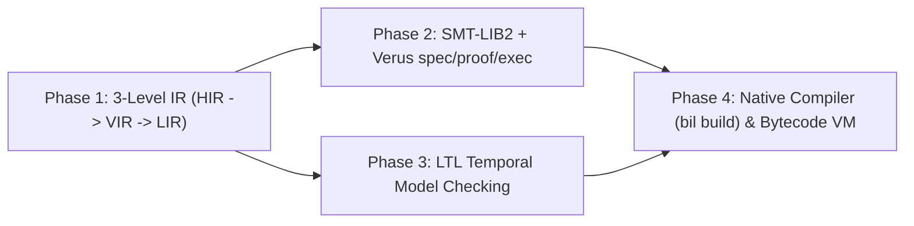

# Roadmap (`bil`)

## Milestone v0.1: Foundation, GCL, Model Checker & Verus Frontend (COMPLETED)
- **Status**: Shipped & Verified (8/8 integration tests, 5/5 domain examples passing `bil all` & `bil emit-verus`).

---

## Milestone v0.2: Multi-Level IR (`HIR`/`VIR`/`LIR`), Unbounded Verification & Native Compiler

### Phase 1: Multi-Level Intermediate Representation (`src/ir/`)
- **Goal**: Introduce `hir.rs`, `vir.rs`, and `lir.rs` between the surface parser/typechecker and the verification/execution backends.
- **Deliverables**:
  - `src/ir/hir.rs`: Type-annotated, ontology-flattened, pipeline-desugared HIR.
  - `src/ir/vir.rs`: Verification IR separating `Ghost` (`spec`/`axiom`/`invariant`/`variant`) from `Exec` code.
  - `src/ir/lir.rs`: Ghost-erased executable IR lowering nondeterministic guards (`[]`) and `do..od` loops into deterministic control flow.
  - `bil dump-ir <file.bil> [--level hir|vir|lir]` CLI inspection command.

### Phase 2: SMT-LIB2 Backend & Verus `spec`/`proof`/`exec` Stratification
- **Goal**: Pair the built-in bounded counterexample finder with unbounded SMT-LIB2 (`z3`) discharge and Verus `proof` blocks.
- **Deliverables**:
  - `src/smt.rs`: SMT-LIB2 emitter and solver driver for `VIR` proof obligations.
  - Enhanced `src/verus.rs` supporting `proof` lemmas and resource/lock invariants.

### Phase 3: Temporal Logic (`LTL`) & Fairness in Explicit-State Model Checker
- **Goal**: Extend `model_check.rs` beyond safety invariants and variants to verify liveness (`eventually` / `leads_to`) and cycle detection.

### Phase 4: Native AOT Compiler (`bil build`) & Register Bytecode VM
- **Goal**: Lower Ghost-Erased `LIR` into standalone native binaries (via `rustc`/LLVM) and a fast register bytecode VM.
