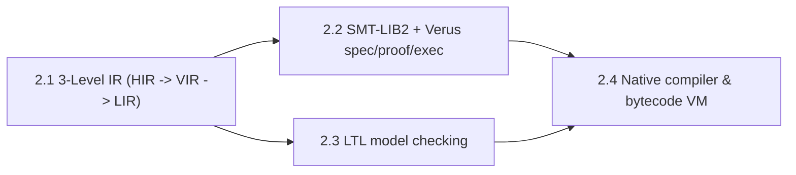

# Roadmap (`bil`)

## Numbering

Planning IDs are `N.P.T` = Milestone.Phase.Task (for example `7.3.4` is Milestone 7, Phase 3, Task 4).

Release versions line up with milestones: **Milestone N ships as release `v0.N.0`.** A fix released between milestones is `v0.N.Z` with `Z` counting patches (this `Z` is a release patch number, not a task number).

Milestones 1 to 6 are already released and match the git tags `v0.1.0` to `v0.6.0`. Milestone 7 is implemented on `main` but not yet released. The crate version in `Cargo.toml` is 0.6.0 and will move to 0.7.0 when Milestone 7 is released.

| Milestone | Release | Name | Status |
|---|---|---|---|
| 1 | v0.1.0 | Foundation, GCL, Model Checker & Verus Frontend | Released |
| 2 | v0.2.0 | Multi-Level IR, Unbounded Verification & Native Compiler | Released |
| 3 | v0.3.0 | Soundness, Architecture Consolidation & Security Hardening | Released |
| 4 | v0.4.0 | Verification Depth & Performance | Released |
| 5 | v0.5.0 | Strict Exit Codes, CLI Validation & Type Soundness | Released |
| 6 | v0.6.0 | CI Gate, Counterexample Values & Hardening | Released |
| 7 | v0.7.0 | Timed Guards, SMT Unfolding, Recursion & System to Verus Refinement | Implemented on `main`, not released |
| 8 | v0.8.0 | Solver independence | Planned |

Milestones 3 to 6 were not in the earlier roadmap. They are filled in from `CHANGELOG.md` and the git tags. Task lines for them are shortened summaries; the CHANGELOG entry for each release has the detail.

---

## Milestone 1 (v0.1.0): Foundation, GCL, Model Checker & Verus Frontend

### Phase 1.1: Baseline
- 1.1.1 Dual ASCII/Unicode lexer and Pratt parser (`lexer.rs`, `parser.rs`) — REQ-001
- 1.1.2 OntoLogic `concept` hierarchy, DAG cycle linter, `.logic` importer (`ontology.rs`) — REQ-002
- 1.1.3 Hindley-Milner type inference, nominal subtyping, `match` exhaustiveness (`types.rs`) — REQ-003
- 1.1.4 Weakest-precondition and refinement verifier (`wp.rs`) — REQ-004
- 1.1.5 Explicit-state BFS model checker for `system` blocks (`model_check.rs`) — REQ-005
- 1.1.6 Verus code generation (`verus.rs`) and tree-walk interpreter (`eval.rs`) — REQ-006

---

## Milestone 2 (v0.2.0): Multi-Level IR, Unbounded Verification & Native Compiler

### Phase 2.1: Multi-Level Intermediate Representation (`src/ir/`)
- 2.1.1 `hir.rs`: type-annotated, ontology-flattened, pipeline-desugared HIR — REQ-101
- 2.1.2 `vir.rs`: verification IR separating ghost (`spec`/`axiom`/`invariant`/`variant`) from exec — REQ-102
- 2.1.3 `lir.rs`: ghost-erased executable IR; lowers `[]` and `do..od` to deterministic control flow — REQ-103
- 2.1.4 `bil dump-ir <file.bil> [--level hir|vir|lir]`

### Phase 2.2: SMT-LIB2 Backend & Verus `spec`/`proof`/`exec`
- 2.2.1 `src/smt.rs`: SMT-LIB2 emitter and external-solver driver for VIR proof obligations — REQ-201
- 2.2.2 `src/verus.rs`: `proof` lemmas and resource/lock invariants — REQ-202

### Phase 2.3: LTL & Fairness
- 2.3.1 `always`, `eventually`, `leads_to` and weak fairness in `model_check.rs` — REQ-301

### Phase 2.4: Compiler Backend
- 2.4.1 `bil build`: native executables from LIR via `rustc` — REQ-401
- 2.4.2 `bil vm`: register bytecode VM — REQ-402

---

## Milestone 3 (v0.3.0): Soundness, Architecture Consolidation & Security Hardening

### Phase 3.1: Soundness and correctness (changelog IDs P0.1 to P0.6)
- 3.1.1 Proof lemmas no longer assume themselves; vacuous `axiom` sets detected
- 3.1.2 One verdict type (`Proved`, `Refuted`, `BoundedOnly`, `Unknown`); concrete counterexamples take precedence
- 3.1.3 64-bit integer arithmetic unified across backends (Euclidean division, checked overflow)
- 3.1.4 Capture-avoiding substitution and full expression coverage
- 3.1.5 Model checker: parent-pointer traces, `truncated` flag at `--max-states`
- 3.1.6 Verification-condition generation decoupled from solver execution

### Phase 3.2: Architecture consolidation (P1.1 to P1.5)
- 3.2.1 Shared operator evaluation and runtime prelude
- 3.2.2 Central builtin table (`builtins.rs`)
- 3.2.3 Driver and CLI split out of `lib.rs` and `main.rs`
- 3.2.4 `Symbol` interner and structured `BilError` diagnostics
- 3.2.5 Configurable solver and compiler paths

### Phase 3.3: Security (SEC-1 to SEC-5)
- 3.3.1 String and identifier escaping in code generation
- 3.3.2 Atomic temporary-file creation
- 3.3.3 Solver timeout and non-blocking pipe readers
- 3.3.4 Parse and call depth limits, VM fuel
- 3.3.5 Soundness and security regression suites

---

## Milestone 4 (v0.4.0): Verification Depth & Performance

### Phase 4.1: Verification depth (P2.1 to P2.7)
- 4.1.1 Constant-guided boundary sampling; ADT, list and concept witness generation
- 4.1.2 100,000-element cap on materialized ranges
- 4.1.3 SMT string escaping, strict sort mapping, `SolverBackend` trait
- 4.1.4 Temporal-property precomputation; `--format json`; `--seed`; zero clippy warnings
- 4.1.5 `docs/SEMANTICS.md` and a 3-way differential suite (eval, vm, native)

### Phase 4.2: Performance and architecture (P3.1 to P3.3)
- 4.2.1 Incremental `(push 1)`/`(pop 1)` SMT batches and an in-memory cache
- 4.2.2 Symbolic bounded model checking
- 4.2.3 Memoized `CompilationSession` for `bil all`

---

## Milestone 5 (v0.5.0): Strict Exit Codes, CLI Validation & Type Soundness

### Phase 5.1: Behavior changes
- 5.1.1 `bil verify` and `bil all` exit 1 on bounded-only results unless `--allow-bounded`
- 5.1.2 Unknown CLI options and invalid flag values are errors

### Phase 5.2: Type soundness and backend parity (P0.1 to P0.3)
- 5.2.1 Directional subtyping, contravariant function parameters, join types
- 5.2.2 Numeric and comparable constraints on operators
- 5.2.3 Top-level `assert` enforced in the VM and native binaries

### Phase 5.3: Additions (P1.1 to P2.1)
- 5.3.1 `expr_utils.rs` extracted from `wp.rs`
- 5.3.2 One incremental solver session for multi-obligation functions
- 5.3.3 Runtime concept instance store in native binaries
- 5.3.4 `bil model-check --bmc <k>`
- 5.3.5 `cargo-fuzz` targets; end-to-end CLI tests

---

## Milestone 6 (v0.6.0): CI Gate, Counterexample Values & Hardening

### Phase 6.1: Quality gate
- 6.1.1 `scripts/ci.sh`: clippy `-D warnings`, coverage floor, `cargo audit`; optional pre-push hook

### Phase 6.2: Diagnostics
- 6.2.1 Type errors point at the offending subexpression
- 6.2.2 SMT counterexamples show concrete values

### Phase 6.3: Fixes and security
- 6.3.1 Solver timeout applies even when the script is large
- 6.3.2 Substitution no longer captures `match` and `do..od` binders
- 6.3.3 Whole-valued Floats keep their decimal point
- 6.3.4 16 MiB source-size limit; recursion and loop limits in native binaries; validated `BIL_RUSTC_PATH`

---

## Milestone 7 (v0.7.0): Timed Guards, SMT Unfolding, Recursion & System to Verus Refinement

Implemented on `main`; listed under `[Unreleased]` in `CHANGELOG.md`. Not tagged. Releasing needs the user's go-ahead.

### Phase 7.1: Timed guards
- 7.1.1 `clock` and `deadline` in `system` blocks, lowered to `Deadline_`/`Latch_`/`Stall_` invariants (`bil::timed`)
- 7.1.2 Seeded bug `spe_late_cutoff.bil`; semantics in `docs/SEMANTICS.md` §4.3

### Phase 7.2: SMT proofs through user functions and recursion
- 7.2.1 Calls to user-defined `fn` unfolded, with callee `requires`/`ensures` at the call site
- 7.2.2 `variant` on recursive functions; induction in the SMT query
- 7.2.3 Bounded cross-check sample budget (10,000 combinations, pairwise covering start)
- 7.2.4 Interpreter call-depth exhaustion is skipped, not a counterexample

### Phase 7.3: System to Verus refinement (`bil emit-verus`)
Plan: `docs/superpowers/plans/2026-10-26-system-to-verus-refinement.md`. Spec: `docs/superpowers/specs/2026-10-25-system-to-verus-refinement-design.md`.
Proves that safety invariants are preserved by the emitted steps. Does not cover LTL liveness, wrong axioms, or hand-written Rust refining `next`.
- 7.3.1 Make existing emission compile and verify (all 14 domain examples)
- 7.3.2 `step_<i>` function per transition
- 7.3.3 `next` relation and timed systems (commit 03c2b48 covers 7.3.1 to 7.3.3)
- 7.3.4 Negative tests: 6 seeded safety bugs rejected by Verus, 5 classified out of scope (commit 97e411e)
- 7.3.5 CI, docs, honesty: `scripts/ci.sh` Verus step, `scripts/VERUS_VERSION` pin (commit 9fc4510)

### Phase 7.4: Project site
- 7.4.1 GitHub Pages landing page, `docs/index.html` (commits 94f8a31, 122011d)

---

## Milestone 8 (v0.8.0): Solver independence (PLANNED, not started)

Analysis: `docs/SOLVER-CONSIDERATIONS.md` (option D). Effort is an estimate: 8 to 16 weeks.

- **Goal**: `bil verify` can produce PROVED with no external solver installed, for the queries it can decide. z3, cvc5 and vampire remain the default and the fallback for everything else.
- **Non-goals**: beating z3; a general SMT solver (option E); removing the external provers.

### Phase 8.1: In-repo solver for a fixed fragment
- 8.1.1 **Measure** (about 1 day, no changes to `src/`)
  - Run the 14 domain examples and record which SMT features each emitted query uses (`Int`, `Real`, `forall`, `exists`, uninterpreted sorts and functions).
  - Record what `solve` and `model-check --bmc` do with no solver installed.
  - **Decision gate**: continue only if the decidable fragment covers most queries. Otherwise stop and reconsider options B, C or F.
- 8.1.2 **Fragment and interface**
  - Define the fragment (candidate: quantifier-free linear integer and real arithmetic, booleans, bounded finite domains).
  - Add a `bil-smt` backend behind `--prover` in `src/smt.rs`. Outside the fragment it returns `unknown`, never a guess.
- 8.1.3 **Decision procedure** for the fragment, unit-tested against z3's answers on the same queries.
- 8.1.4 **Soundness gate**
  - Differential test: every query in the repo's examples and tests gives the same sat/unsat answer as z3. Any disagreement fails CI.
  - The seeded-bug suite (`tests/domain_examples.rs`) is still caught with `bil-smt` as the only prover.
- 8.1.5 **Wire-in**
  - `--prover auto` tries an installed solver first, then `bil-smt`. Results are labelled `PROVED (by bil-smt)`.
  - Update README solver wording, CHANGELOG, `docs/SEMANTICS.md`.

### Phase 8.2: Proof checking (not scheduled)
- 8.2.1 Option F: check z3 proof certificates inside bil.
