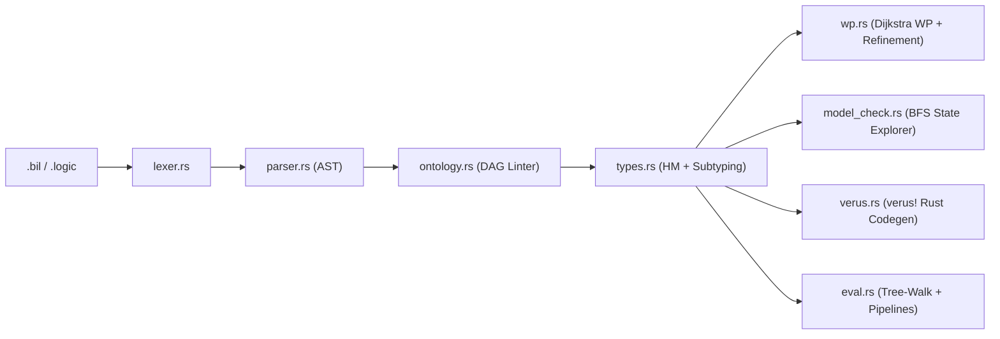
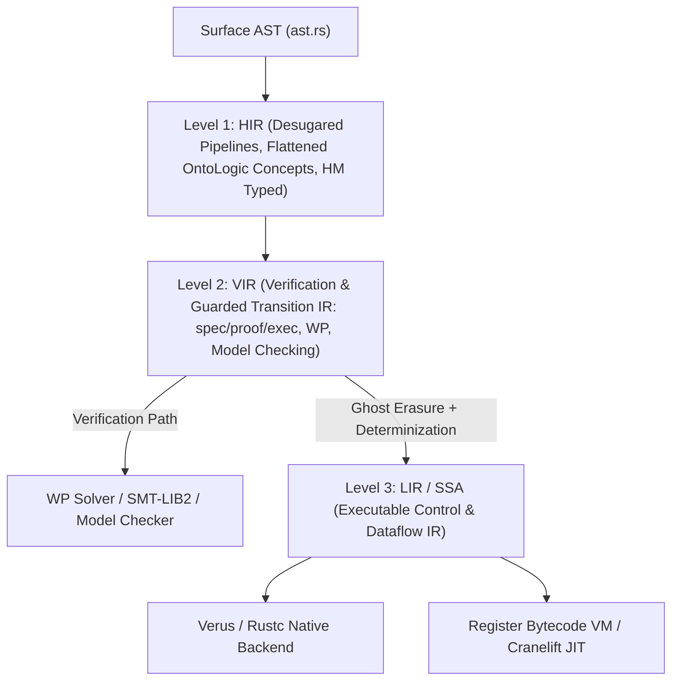

# Architecture (`bil`)

## Current v0.1 Pipeline

## Target v0.2 Multi-Level IR Architecture (`HIR` -> `VIR` -> `LIR`)

## Core Invariants
1. **OntoLogic Taxonomic Acyclicity**: Every `concept` hierarchy must form a strict DAG (`ontology.rs`).
2. **True Nondeterminism (`[]` & `choose`)**: Guards in `if..fi`, `do..od`, and `system` transitions are evaluated without order bias; deductive proofs (`wp.rs`) must hold for *all* enabled guards demonically, and model checking (`model_check.rs`) explores *all* enabled branches.
3. **Total Guard Coverage ($BB$)**: Executing `if..fi` when $\neg(\bigvee G_i)$ is a static `wp` failure and runtime abort.
