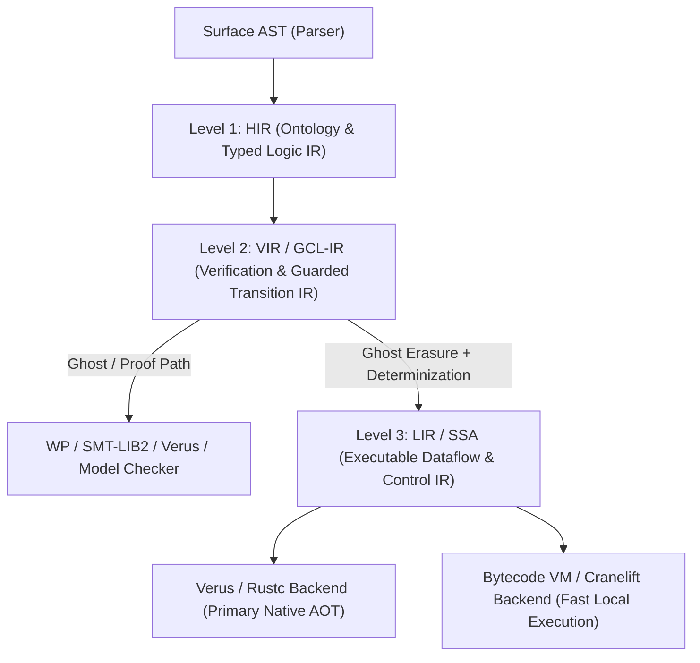

# `bil` Language Architecture, Multi-Level IR & Verus Integration

**`bil`** (Bounded Invariant Logic) is a mathematically grounded, statically typed formal modeling, verification, and functional data language written in Rust. It unifies **OntoLogic** (Basic Formal Ontology + First-Order Logic), **Dijkstra's Guarded Command Language (GCL)**, **Refinement Calculus**, **SPIN/Promela-style Explicit-State Model Checking**, **Verus-compatible Deductive Rust Verification**, and **Hindley-Milner Functional Data Pipelines**.

---

## 1. Purpose, Intended Use & Practical Applications

### Purpose
Modern safety-critical, distributed, and data-intensive systems suffer from a **specification-implementation split**:
1. **Domain ontologies & business rules** are written in static schemas (OWL, SQL/Cypher, or OntoLogic `.logic` files) disconnected from control flow.
2. **Formal protocols & safety proofs** are modeled in standalone academic tools (TLA+, Alloy, SPIN/Promela, Dafny) that cannot directly process live data pipelines.
3. **Production data pipelines & control logic** are written in general-purpose languages where `if/else` masks unhandled edge cases, loops lack termination/invariant proofs, and concurrency bugs only surface in production.

**`bil`'s purpose** is to close this gap: providing a single language where **domain ontologies (OntoLogic), mathematical specifications (First-Order Logic), nondeterministic concurrent models (GCL), formal proofs (`wp`, model checking & Verus codegen), and executable data transformations (`|>` pipelines)** coexist and verify one another before a single packet or state transition runs in production.

### Intended Use
1. **Domain & Ontology Modeling**: Define BFO-grounded `concept` hierarchies (`<:`), ADTs (`type`), and universal domain `axiom`s (`forall` / `exists`) with compile-time DAG cycle and type checking.
2. **Specification & Protocol Design (Deferring Implementation Details)**: Write high-level `spec` contracts and nondeterministic `system` state machines (`[]`, `choose`) to explore concurrency, failure modes, and asynchronous interleavings using `bil model-check` before committing to low-level implementation choices.
3. **Correct-by-Construction Refinement**: Refine abstract specifications (`refines` / `⊑`) into executable Guarded Command functions (`if ... fi`, `do ... od`) carrying explicit `requires`, `ensures`, `invariant`, and `variant` clauses proved via `bil verify` (Weakest Precondition calculus).
4. **Verified Data & Telemetry Execution**: Run validated `|>` functional pipelines and FOL queries (`where`, `map`, `select`, `sort_by`) over telemetry (`bil run`), guaranteeing that every record and state transition satisfies all ontological axioms and postconditions.
5. **Provably Correct Rust Codegen via Verus (`bil emit-verus`)**: Compile verified `bil` ontologies, `spec` functions, GCL loops, and state machines directly into Verus-annotated Rust (`verus! { ... }`).

### Practical Applications
| Domain | Concrete Application in `bil` | Example Artifact |
| :--- | :--- | :--- |
| **1. Industrial IoT, SCADA & Smart Energy (OntoLogic / HiveMQ)** | Validate telemetry streams from PLCs, pumps, valves, and pipelines against BFO ontologies; verify autonomous pressure-relief and emergency-shutdown control loops (`do .. od`) cannot deadlock or violate pressure bounds. | [`examples/smart_grid.bil`](../examples/smart_grid.bil) |
| **2. Distributed Systems & Network Protocols (Anvil / SPIN style)** | Model and exhaustively verify mutual exclusion, consensus, Kubernetes/cloud controller liveness, and MQTT/broker QoS state machines with true nondeterministic interleaving (`[]`), proving deadlock freedom and safety invariants (`bil model-check`). | [`examples/mutex_protocol.bil`](../examples/mutex_protocol.bil) |
| **3. Hardware, Hypervisors & Isolation Engines (Nitro / CortenMM style)** | Specify asynchronous arbiters, separation kernels, custom lock invariants, and finite-state controllers where multiple request guards fire simultaneously (`[]`); prove total guard coverage ($BB$) and fair progress (`variant`). | [`examples/arbiter_controller.bil`](../examples/arbiter_controller.bil) |
| **4. Safety-Critical Control & Verified Algorithms (Verus / Dijkstra style)** | Develop numerical, binary-search, parser (Vest-style), and scheduling algorithms alongside their Hoare/Dijkstra proofs (`requires`, `ensures`, `invariant`, `variant`) and formal refinement (`refines`) from mathematical `spec`s. | [`examples/gcd_refinement.bil`](../examples/gcd_refinement.bil) |
| **5. Zero-Trust Policy & Certificate Auditing (Verdict style)** | Express x.509 certificate validation, access-control, and cloud-datacenter policies in First-Order Logic (`forall`, `exists`, `=>`) and evaluate them over infrastructure datasets via `|>` pipelines. | [`examples/security_policy.bil`](../examples/security_policy.bil) |

---

## 2. Multi-Level IR Architecture (`HIR` $\to$ `VIR` $\to$ `LIR`) & Compiler Backend Strategy

### Why a 3-Level IR is Essential for `bil`
A single AST is too high-level for simultaneous deductive verification, state-space exploration, and code generation. Because `bil` unifies **OntoLogic + FOL + Nondeterministic GCL + Functional Pipelines**, a **3-Level IR** (inspired by MLIR, Verus's VIR, and Rust's HIR/MIR) cleanly separates concerns:

1. **Level 1 — HIR (`src/ir/hir.rs` — Ontology & Typed Logic IR)**:
   - Flattens BFO `concept` inheritance (`Pipeline <: Equipment <: MaterialEntity`), resolves all field layouts, desugars `|>` pipelines and `_` partial applications into explicit operations, and attaches resolved Hindley-Milner + subtyping types (`Type`) to every expression and declaration.
2. **Level 2 — VIR (`src/ir/vir.rs` — Verification & Guarded Transition IR)**:
   - Explicit stratification into **`Ghost` (`Spec` / `Proof`)** and **`Exec`** nodes (directly mirroring Verus's `spec` / `proof` / `exec` modes).
   - Represents `axiom`, `spec`, `requires`, `ensures`, `invariant`, `variant`, and true nondeterministic guarded transitions (`[]`, `choose`) as explicit Verification Conditions (VCs) and transition systems.
3. **Level 3 — LIR (`src/ir/lir.rs` — Ghost-Erased Executable Control & Dataflow IR)**:
   - **Ghost Erasure**: Strips `axiom`, `spec`, `requires`, `ensures`, `invariant`, and `variant` once proved in `VIR` (zero runtime overhead, matching Verus).
   - **Nondeterminism Lowering**: Lowers verified `[]` and `choose` into deterministic schedules or seeded selection and lowers `do ... od` into structured basic-block / loop instructions.

### Compiler Backend Trade-Offs (Rust/Verus vs. VM vs. LLVM)

| Backend Option | Pros for `bil` | Cons / Trade-offs | Role in `bil` |
| :--- | :--- | :--- | :--- |
| **1. Tiered `LIR -> Verus / Rustc` (`rustc` $\to$ LLVM)** | • **Gets LLVM optimizations for free** via `rustc` without maintaining unsafe C++ FFI. • **Preserves proofs end-to-end**: `verus` verifies the generated Rust, and `rustc` compiles it to native machine code. | Slower cold compile times if invoking `rustc` on large generated files. | **Primary AOT Production Backend** |
| **2. `LIR -> Bytecode VM / Cranelift`** | • **Pure Rust, 10x faster compile times**, zero external C++ build dependencies. • Ideal for interactive `bil run`, REPL, and high-throughput streaming data pipelines (`|>`). | ~10–20% slower peak numeric code than `rustc -O3` / LLVM. | **Primary Fast Execution Backend** |
| **3. Direct LLVM (`inkwell` / `llvm-sys`) or MLIR (`melior`)** | • Full control over custom LLVM passes and vectorization. | • Massive `libllvm` C++ dependency. • LLVM IR has no concept of `forall`, `invariant`, or nondeterministic `[]`—verification *must* happen in `VIR` before lowering anyway. | **Optional Phase 5+ Target** |

---

## 3. How `bil` Works With & Draws Inspiration From Verus

[Verus](https://www.amazon.science/blog/developing-provably-correct-rust-code-with-verus) (developed by CMU, Amazon, Microsoft, and academic collaborators, and used in AWS's Nitro Isolation Engine) introduces key innovations for verifying systems Rust code. `bil` both **adopts Verus's core verification idioms** and **acts as a high-level OntoLogic + GCL frontend that compiles down to Verus (`bil emit-verus`)**:

1. **Ghost `spec` vs. `proof` vs. `exec` Function Modes**:
   - `axiom` and `spec` declarations act as pure ghost specifications (erased in `LIR`), while `fn` and `|>` pipelines are `exec` code verified against `spec` via `requires` / `ensures` / `refines`.
2. **Completeness of Postconditions & Guard Totality**:
   - Enforces total guard coverage ($BB = \bigvee G_i$) and full biconditional/exhaustive ADT postconditions to prevent vacuous specifications.
3. **Lock & State-Machine Invariants**:
   - `system` blocks attach structural `invariant`s to shared state variables that must hold at initialization and be preserved across every nondeterministic transition (`[]`).
4. **Sub-Second Agentic Feedback Loop**:
   - `bil verify` and `bil model-check` return immediate source-level counterexamples (`{ a = ..., x = ... }`) and shortest witness traces.
5. **Direct Transpilation (`bil emit-verus`)**:
   - Emits self-contained `verus! { ... }` Rust code from `.bil` programs (`src/verus.rs`).
