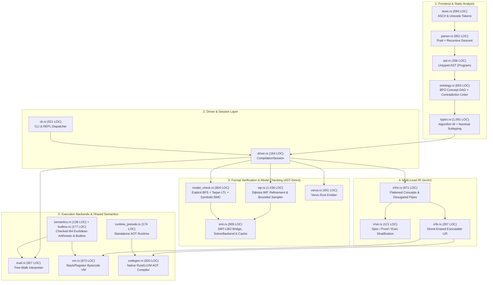
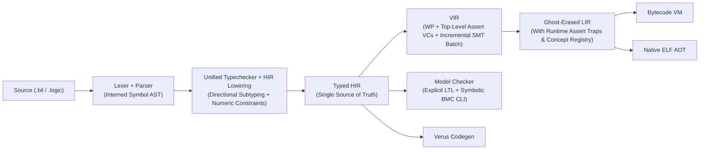

# `bil` Code & Architecture Review (`v0.4.0`)

**Repository**: `bil` — Bounded Invariant Logic (`OntoLogic` + First-Order Logic + Dijkstra Guarded Command Language + 3-Level IR + Verus + Bytecode VM + Native AOT)  
**Version Audited**: `v0.4.0` (`4cf5006`)  
**Codebase Scale**: 24 Rust source modules (`12,444` LOC in `src/`) + 4 integration test suites (`1,188` LOC in `tests/`, `33/33` tests passing, `0` Clippy warnings)  
**Graphify Structural Topology**: 463 nodes · 1,504 edges · 26 communities · 0 import cycles

---

## Completed Remediation Ledger (`v0.2.0` $\to$ `v0.4.0`)

All 23 findings from the baseline `v0.2.0` architecture and security audit have been implemented, verified, and released across `v0.3.0` (`4ce560c`) and `v0.4.0` (`4cf5006`):

| Phase | IDs | Summary of Delivered Changes | Release |
| :--- | :--- | :--- | :--- |
| **P0 Soundness** | `P0.1`–`P0.6` | Non-circular lemma assumption order; `Status` lattice where concrete counterexamples override SMT; checked 64-bit Euclidean `div`/`mod` across all backends; capture-avoiding `subst_expr`; $O(1)$ parent-pointer BFS model checking with truncation reporting; solver-free `VIR` lowering. | `v0.3.0` |
| **P1 Consolidation** | `P1.1`–`P1.5` | Shared `src/semantics.rs` & compile-tested `src/runtime_prelude.rs`; unified `src/builtins.rs`; `src/driver.rs` + `src/cli.rs` split; `SymbolInterner` (`src/symbol.rs`) & `BilError` (`src/error.rs`); configurable solver/compiler binary resolution. | `v0.3.0` |
| **SEC Hardening** | `SEC-1`–`SEC-5` | Verus string escaping & Rust identifier sanitization; atomic `create_new(true)` temp files; non-blocking pipe threads + wall-clock solver timeout; parser/evaluator recursion limits & VM instruction fuel; `tests/security.rs` + `tests/soundness.rs`. | `v0.3.0` |
| **P2 Verification Depth** | `P2.1`–`P2.7` | Constant-guided boundary sampling ($c-1, c, c+1$), ADT/List/skewed `ConceptInstance` domains; `100,000`-element range cap; SMT string escaping & `SolverBackend` trait (`ProcessSolver`, `MockSolver`); single-pass Tarjan SCC liveness check; `--format json` & `vm --seed`; `docs/SEMANTICS.md`; 3-way differential test suite (`tests/differential.rs`). | `v0.4.0` |
| **P3 Scale & Speed** | `P3.1`–`P3.3` | Incremental `(push 1)`/`(pop 1)` SMT batch runner & `SMT_CACHE`; Symbolic Bounded Model Checking (`symbolic_bmc_program`); memoized `CompilationSession`. | `v0.4.0` |

---

## 1. Code Architecture

### 1.1 Architectural Paradigm
`bil` is a **multi-paradigm formal specification, verification, and compilation pipeline** structured as a staged compiler with four backend targets:
1. **Deductive Verification Backend**: Dijkstra Weakest-Precondition (`wp`) calculus + First-Order Logic SMT-LIB2 refutation (`Z3` / `CVC5` / `Vampire`) + Verus (`verus! { ... }`) Rust transpilation.
2. **Model-Checking Backend**: Explicit-state BFS + Tarjan SCC weak-fairness LTL verifier + SMT-LIB2 Symbolic Bounded Model Checker (`symbolic_bmc_program`).
3. **Tree-Walk Reference Interpreter**: Direct AST evaluator (`src/eval.rs`) with closed-world concept quantification.
4. **Ghost-Erased Compilation Pipeline**: 3-Level IR (`HIR` $\to$ `VIR` $\to$ `LIR`) feeding a Register/Stack Bytecode VM (`src/vm.rs`) and a standalone Native ELF AOT compiler (`src/codegen.rs`).

### 1.2 Current System Architecture (`v0.4.0`)



### 1.3 Target State Architecture Blueprint (`v0.5.0`)



### 1.4 Remaining Architectural Debt Summary
1. **Symmetric `common_ancestor` Unification at Directional Check Sites (`src/types.rs`)**: `TypeEnv::unify` conflates least-upper-bound join (`lub`) with directional subtyping (`sub <: sup`), allowing sibling concepts (e.g., passing a `Valve` where a `Pipeline` is required) to typecheck whenever they share a base concept (`Equipment`).
2. **Unconstrained Operand Types in Arithmetic & Relational Inference (`src/types.rs`)**: Binary operators `+`, `-`, `*`, `/`, `%`, `<`, `<=`, `>`, `>=` unify left and right operands with each other (`unify(&lt, &rt)`) without constraining the resulting type to `Int`/`Float`/`Str`.
3. **Top-Level `assert` Declarations Ignored by `wp`, `LIR`, `VM`, and `AOT` (`src/ir/lir.rs`, `src/wp.rs`)**: Top-level `assert P` items are only evaluated in `bil run` (`eval.rs`); they generate zero proof obligations in `bil verify` and are silently discarded during `HIR` $\to$ `LIR` lowering in `bil vm` and `bil build`.
4. **Dual-Frontend AST vs. HIR Split**: `wp.rs`, `smt.rs`, `model_check.rs`, `verus.rs`, and `eval.rs` still operate on untyped `ast::Program`, while `ir/hir.rs` re-runs `tenv.infer_expr` on every subexpression to reconstruct types that `TypeEnv::check_program` already computed but discarded.
5. **Unwired Infrastructure (`SymbolInterner` & Incremental SMT Batching)**: `SymbolInterner` (`src/symbol.rs`) and `run_smt_incremental_batch` (`src/smt.rs`) are unit-tested but not yet wired into the main AST/VM lookup paths or `wp::verify_program`.

---

## 2. Code Module & Component Review

### 2.1 Module Scorecard (`v0.4.0`)

| Module | LOC | Cohesion | SRP | Type Safety | Error Handling | Notes / Hotspots |
| :--- | ---: | :---: | :---: | :---: | :---: | :--- |
| `src/wp.rs` | 1,438 | Medium | **Low** | High | High | **God-module**: mixes VC data types, substitution, domain sampling, WP calculus, and SMT orchestration. |
| `src/types.rs` | 1,091 | High | High | **Medium** | High | Directional subtyping bug in `unify` (`common_ancestor`); unconstrained arithmetic/comparison operands. |
| `src/parser.rs` | 952 | High | High | High | High | Clean Pratt + recursive descent with `MAX_PARSE_DEPTH` guard. |
| `src/eval.rs` | 927 | Medium | Medium | High | High | Reference tree-walk interpreter; duplicates `HIR` pipe desugaring. |
| `src/smt.rs` | 909 | High | High | High | High | `SolverBackend` trait, timeout guard, `SMT_CACHE`, and incremental batching. |
| `src/model_check.rs` | 904 | High | Medium | High | High | Explicit-state BFS + Tarjan LTL + Symbolic BMC (`emit_symbolic_bmc_smt2`). |
| `src/vm.rs` | 873 | High | High | High | High | Stack/register bytecode compiler & VM with fuel bounds; uses `String` var lookups. |
| `src/codegen.rs` | 820 | High | High | High | High | Native Rust/LLVM AOT codegen; missing runtime concept registry for `forall x in Concept`. |
| `src/ir/hir.rs` | 671 | High | Medium | Medium | Medium | Re-runs `tenv.infer_expr` with `dummy_span` instead of capturing types during `check_program`. |
| `src/ontology.rs` | 653 | High | High | High | High | BFO DAG validation, static contradiction linter, `.logic` S-expression transpiler. |
| `src/lexer.rs` | 594 | High | High | High | High | Dual ASCII/Unicode tokenizer with span tracking. |
| `src/cli.rs` | 521 | High | High | High | High | Supports `--format json`, `--seed`, and `CompilationSession`. |
| `src/verus.rs` | 451 | High | High | High | High | Emits `verus! { ... }` specs, proofs, exec fns, and state machines. |
| `src/ast.rs` | 356 | High | High | High | High | Core AST definitions; expression nodes lack fine-grained per-node `Span`s. |
| `src/ir/lir.rs` | 267 | High | High | Medium | High | Ghost-erased executable IR; silently drops `hir.asserts`. |
| `src/builtins.rs` | 177 | High | High | High | High | Single source of truth for builtins & pipeline stage metadata. |
| `src/runtime_prelude.rs` | 174 | High | High | High | High | Compile-tested standalone AOT runtime prelude with seeded Xorshift64* PRNG. |
| `src/driver.rs` | 164 | High | High | High | High | Pipeline facade and memoized `CompilationSession`. |
| `src/semantics.rs` | 138 | High | High | High | High | Checked 64-bit Euclidean arithmetic & pattern matching shared by `eval` and `vm`. |
| `src/ir/vir.rs` | 121 | Medium | High | High | High | Stratifies `Spec`/`Proof`/`Exec`; currently delegates to `wp::generate_program_obligations`. |
| `src/symbol.rs` | 98 | High | High | High | High | `Symbol` + `SymbolInterner` (currently standalone, not yet wired into AST/VM). |
| `src/error.rs` | 89 | High | High | High | High | Structured `BilError` enum across pipeline stages. |

### 2.2 Intra-Module Deep Dive Findings

1. **`src/types.rs` (Lines 157–171) — Unsound Sibling Concept Unification via `common_ancestor`**:
   - In [`TypeEnv::unify`](file:///home/bill/src/lang/bil/src/types.rs#L157-L171), unifying `actual = Type::Concept("Valve")` with `expected = Type::Concept("Pipeline")` succeeds with `Ok(Type::Concept("Equipment"))` because `common_ancestor("Valve", "Pipeline")` is `Some("Equipment")`.
   - When `unify` is called from [`check_item` (`Item::Let`)](file:///home/bill/src/lang/bil/src/types.rs#L483), [`infer_expr` (`Expr::RecordInit`)](file:///home/bill/src/lang/bil/src/types.rs#L795), or [`infer_expr` (`Expr::Call`)](file:///home/bill/src/lang/bil/src/types.rs#L925), the caller discards the returned `Type::Concept("Equipment")` and assumes `actual` satisfied `expected` (`Pipeline`)!
   - Furthermore, [`Type::Fn` unification](file:///home/bill/src/lang/bil/src/types.rs#L181-L188) unifies parameter types covariantly (`self.unify(x, y, span)`), violating function parameter contravariance.

2. **`src/types.rs` (Lines 562–585) — Missing Domain Constraints on Arithmetic & Relational Operators**:
   - [`BinOp::Add | Sub | Mul | Div | Mod`](file:///home/bill/src/lang/bil/src/types.rs#L581-L585) and [`BinOp::Lt | Le | Gt | Ge`](file:///home/bill/src/lang/bil/src/types.rs#L562-L567) only call `self.unify(&lt, &rt, span)` without checking that the operand type is numeric (`Int` / `Float`) or `Str`.
   - Consequently, `true + false` or `[1, 2] - [3, 4]` typechecks as `Type::Bool` or `Type::List(Int)` and panics at runtime.

3. **`src/ir/hir.rs` (Lines 172–530) — Redundant Type Inference with Dummy Spans**:
   - [`HirProgram::lower`](file:///home/bill/src/lang/bil/src/ir/hir.rs#L172-L358) constructs a `dummy_span = Span::new(1, 1)` and calls `tenv.infer_expr(expr, &mut local, dummy_span).unwrap_or(Type::Unit)` at every node in `lower_expr`, repeating all Hindley-Milner unification work already performed by `tenv.check_program(program)`.

4. **`src/wp.rs` (1,438 LOC) — Monolithic Verification Module**:
   - `src/wp.rs` has grown to 1,438 lines across five distinct responsibilities:
     1. Verification status & obligation model (`Status`, `ObligationKind`, `ProofObligation`, `decide_status`).
     2. Symbolic expression utilities (`free_vars`, `subst_expr`, `format_expr_concise`).
     3. Bounded witness & counterexample generator (`extract_int_constants`, `sample_domain_for_type`, `find_counterexample`).
     4. Dijkstra WP & GCL verification condition generator (`wp_expr`, `collect_loop_obligations`, `generate_program_obligations`).
     5. SMT solver & lemma orchestration (`verify_program`).

---

## 3. Code Inter-Module Review

### 3.1 Inter-Module Dependency Matrix

| Caller $\downarrow$ / Callee $\rightarrow$ | `ast` | `ontology` | `types` | `semantics` / `builtins` | `ir` (`hir`/`vir`/`lir`) | `wp` | `smt` | `model_check` | `eval` | `vm` / `codegen` |
| :--- | :---: | :---: | :---: | :---: | :---: | :---: | :---: | :---: | :---: | :---: |
| `driver.rs` | ✓ | ✓ | ✓ | — | ✓ | ✓ | ✓ | ✓ | ✓ | ✓ |
| `types.rs` | ✓ | ✓ | — | `builtins` | — | — | — | — | — | — |
| `wp.rs` | ✓ | ✓ | — | — | — | — | ✓ | — | ✓ | — |
| `smt.rs` | ✓ | ✓ | — | `builtins` | — | `format_expr` | — | — | — | — |
| `model_check.rs` | ✓ | ✓ | — | — | — | `subst_expr` | ✓ | — | ✓ | — |
| `ir/hir.rs` | ✓ | ✓ | ✓ | `builtins` | — | — | — | — | — | — |
| `ir/vir.rs` | ✓ | ✓ | ✓ | — | `hir` | ✓ | — | — | — | — |
| `ir/lir.rs` | ✓ | — | ✓ | — | `hir` | — | — | — | — | — |
| `vm.rs` | ✓ | ✓ | — | ✓ | `hir`, `lir` | — | — | — | `Value` | — |
| `codegen.rs` | ✓ | — | ✓ | — | `hir`, `lir` | — | — | — | — | `runtime_prelude` |

### 3.2 Coupling, Cohesion & Boundary Findings

1. **Zero Import Cycles, Clean Shared Semantics Core**:
   - The extraction of `src/semantics.rs`, `src/builtins.rs`, `src/runtime_prelude.rs`, and `src/driver.rs` in `v0.3.0`–`v0.4.0` eliminated the triplicated arithmetic/builtin logic between `eval`, `vm`, `codegen`, and `smt`.
2. **Bidirectional Coupling Between `wp.rs` and `smt.rs` / `model_check.rs`**:
   - `smt.rs`, `model_check.rs`, and `verus.rs` import `wp::subst_expr` and `wp::format_expr_concise`. Moving `subst_expr`, `free_vars`, and `format_expr_concise` into `src/ast.rs` (or a dedicated `src/expr_utils.rs`) will make `wp.rs`, `smt.rs`, `model_check.rs`, and `verus.rs` peer leaf modules that depend only on `ast`/`ontology` rather than on `wp`.
3. **Top-Level `assert` Contract Gap Across `HIR` $\to$ `LIR` Boundary**:
   - `HirProgram` captures `pub asserts: Vec<HirExpr>`, but neither `VirProgram::lower` nor `LirProgram::lower_with_ghost_erasure` consumes `hir.asserts`. As a result, `bil run` enforces top-level `assert` statements, while `bil verify`, `bil vm`, and `bil build` silently ignore them.
4. **Concept Quantification Boundary in `codegen.rs`**:
   - `eval.rs` and `vm.rs` pass `OntologyRegistry` into their runtime state and register every allocated `ConceptInstance` into `concept_store` so `forall x in Concept : P(x)` iterates over all live instances (including subconcepts). `codegen.rs` does not emit a runtime concept instance registry, causing `forall x in Concept` in executable `let` bindings to fail with `Unbound variable` in native AOT binaries.

---

## 4. Recommended Improvements (Prioritized Roadmap for `v0.5.0`)

### Phase P0: Type Soundness & Assertion Parity across Backends

#### `P0.1` — Separate Directional Subtyping (`check_subtype`) from Join Unification (`lub_unify`) in `src/types.rs`
- **Problem**: `TypeEnv::unify` uses `ontology.common_ancestor(sub, sup)` for any two concepts sharing an ancestor, allowing sibling concepts (`Valve` vs. `Pipeline`) to pass directional type checks (`let p: Pipeline = Valve { ... }`, function arguments, record field initializers).
- **Before (`src/types.rs:157-171`)**:
```rust
(Type::Concept(sub), Type::Concept(sup)) => {
    if self.ontology.is_subconcept(sub, sup) {
        Ok(Type::Concept(sup.clone()))
    } else if let Some(anc) = self.ontology.common_ancestor(sub, sup) {
        Ok(Type::Concept(anc))
    } else {
        Err(TypeError {
            message: format!("OntoLogic concept '{}' is not compatible with '{}'", sub, sup),
            span,
        })
    }
}
```
- **After (`src/types.rs`)**:
```rust
/// Directional subtype check: requires `actual <: expected` (no sibling join).
pub fn check_subtype(&mut self, actual: &Type, expected: &Type, span: Span) -> Result<Type, TypeError> {
    let a = self.apply(actual);
    let e = self.apply(expected);
    match (&a, &e) {
        (Type::Concept(sub), Type::Concept(sup)) => {
            if self.ontology.is_subconcept(sub, sup) {
                Ok(Type::Concept(sup.clone()))
            } else {
                Err(TypeError {
                    message: format!("Type mismatch: concept '{}' is not a subconcept of '{}'", sub, sup),
                    span,
                })
            }
        }
        _ => self.unify(&a, &e, span),
    }
}
```

#### `P0.2` — Enforce Numeric & Comparable Type Constraints on Arithmetic and Relational Operators (`src/types.rs`)
- **Problem**: `BinOp::Add | Sub | Mul | Div | Mod` and `BinOp::Lt | Le | Gt | Ge` unify `lt` and `rt` without verifying that the unified type supports arithmetic or ordering.
- **Before (`src/types.rs:581-585`)**:
```rust
BinOp::Add | BinOp::Sub | BinOp::Mul | BinOp::Div | BinOp::Mod => {
    let lt = self.infer_expr(left, local, span)?;
    let rt = self.infer_expr(right, local, span)?;
    self.unify(&lt, &rt, span)
}
```
- **After (`src/types.rs`)**:
```rust
BinOp::Mod => {
    let lt = self.infer_expr(left, local, span)?;
    let rt = self.infer_expr(right, local, span)?;
    self.unify(&lt, &Type::Int, span)?;
    self.unify(&rt, &Type::Int, span)
}
BinOp::Sub | BinOp::Mul | BinOp::Div => {
    let lt = self.infer_expr(left, local, span)?;
    let rt = self.infer_expr(right, local, span)?;
    let u = self.apply(&self.unify(&lt, &rt, span)?);
    match u {
        Type::Int | Type::Float | Type::Var(_) => Ok(u),
        other => Err(TypeError {
            message: format!("Arithmetic operator '{:?}' requires Int or Float, found {}", op, other),
            span,
        }),
    }
}
```

#### `P0.3` — Lower Top-Level `assert` Declarations into `LIR`, `BytecodeVm`, Native AOT, and `wp` Verification
- **Problem**: `Item::Assert` is checked in `eval.rs` (`bil run`), but ignored in `LirProgram` (`bil vm`, `bil build`) and `wp::verify_program` (`bil verify`).
- **Remediation**:
  1. Add `pub assertions: Vec<LirExpr>` to `LirProgram` in `src/ir/lir.rs` (populated from `hir.asserts`).
  2. Compile and execute `lir.assertions` in `BytecodeVm::execute` (`src/vm.rs`) and `emit_native_rust_aot` (`src/codegen.rs`), failing with an assertion error if any evaluates to `false`.

---

### Phase P1: Modularization & IR Pipeline Unification

#### `P1.1` — Extract Symbolic Expression Calculus (`src/expr_utils.rs`) and Split `src/wp.rs`
- Extract `free_vars`, `subst_expr`, `format_expr_concise`, and `extract_int_constants` out of `src/wp.rs` into `src/expr_utils.rs` (or `src/ast.rs`), decoupling `smt.rs`, `model_check.rs`, and `verus.rs` from `wp.rs` and reducing `src/wp.rs` below 950 lines.

#### `P1.2` — Wire Incremental SMT Batching (`run_smt_incremental_batch`) into `wp::verify_program`
- When a function with GCL loops generates 5–8 verification conditions over the same ontology base theory and parameter declarations, batch their refutations through `run_smt_incremental_batch` (`(push 1)` / `(pop 1)`) so Z3/CVC5 parses and elaborates the base ontology once per function instead of spawning $N$ separate processes.

#### `P1.3` — Runtime Concept Instance Registry in `runtime_prelude.rs` and `codegen.rs`
- Register `BilVal::Concept` instances in a thread-local/global registry alongside `subClassOf` metadata in `emit_native_rust_aot` so `forall x in Concept : P(x)` in executable `let` bindings behaves identically in `eval`, `vm`, and Native AOT.

---

### Phase P2: CLI & Developer Ergonomics

#### `P2.1` — Expose Symbolic Bounded Model Checking (`--bmc <depth>`) in `bil model-check`
- Wire `symbolic_bmc_program` (`src/model_check.rs`) into `bil model-check <file.bil> [--bmc <k>]` in `src/cli.rs` so users can run SMT-backed symbolic bounded model checking directly from the CLI alongside explicit-state BFS and LTL verification.

#### `P2.2` — Fine-Grained Expression Spans (`Spanned<Expr>`)
- Attach source `Span`s to `Expr` nodes (or `HirExpr` nodes) so type errors inside large function bodies report the exact line and column of the offending subexpression rather than the enclosing `fn` declaration header.

---

## 5. Security & Robustness Recommendations

1. **Attack Surface Status (`v0.4.0`)**:
   - All five prior security findings (`SEC-1` codegen injection, `SEC-2` non-exclusive temp files, `SEC-3` unbounded solver subprocess hangs, `SEC-4` unbounded parser/interpreter/VM recursion/loops, `SEC-5` regression tests) are mitigated and covered by automated tests in [`tests/security.rs`](file:///home/bill/src/lang/bil/tests/security.rs).
2. **Remaining Robustness Boundaries**:
   - **Native AOT Stack Depth**: While `eval` enforces `MAX_CALL_DEPTH = 64` and `vm` enforces `DEFAULT_VM_MAX_STEPS = 1_000_000`, generated Rust AOT functions in `codegen.rs` rely on the OS thread stack for recursion. Adding an atomic/thread-local call-depth counter in `runtime_prelude.rs` (`call_bil_fn`) will bring AOT recursion protection to full parity with `eval` and `vm`.
   - **SMT Quantifier Instantiation Fuel**: First-Order Logic axioms with cyclic function symbols (`f(x) == f(f(x))`) can cause E-matching loops in Z3/CVC5 up to `BIL_SOLVER_TIMEOUT_MS` (`10,000 ms`). Passing `(set-option :smt.mbqi true)` or configurable solver resource limits (`rlimit`) can make solver termination deterministic across host CPU speeds.
3. **Recommended Next Scans**:
   - Run `/security-scan` or `dependency-audit` whenever external crates beyond `serde` and `serde_json` are added to `Cargo.toml`.
