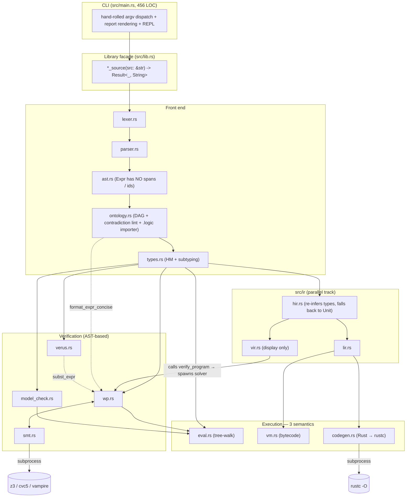
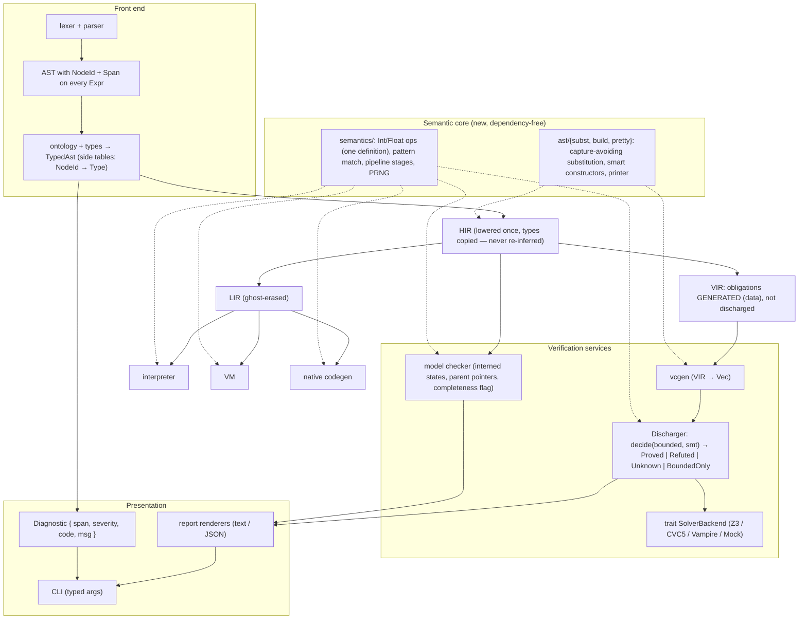
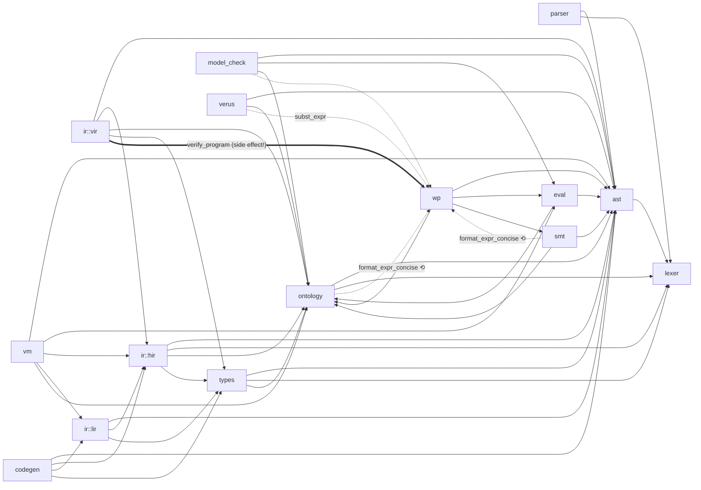

# Architecture & Code Review Improvement Plan: `bil` (Bounded Invariant Logic)

> **Repository:** `bil` (`/home/bill/src/lang/bil`)
> **Date:** `2026-10-17`
> **Revision reviewed:** `9090efe` (v0.2.0)
> **Review Scope:** Full repository (`src/`, `src/ir/`, `tests/`, `examples/`, `Cargo.toml`)
> **Reviewer:** Claude Code (Opus 5.5), `code-architecture-review` skill, Graphify AST graph (463 nodes / 1504 edges / 26 communities) + manual source read + runtime probes
> **Architecture Health Score:** `C-` (Score: `58/100`)

**Score rationale.** The crate layout is clean and readable. The library facade is thin, there are only two dependencies (both unused), all 15 integration tests pass, and the code builds with 0 compiler warnings. Those positives are outweighed by one class of problem: **as a verification tool, `bil` can report `PROVED` / `VERIFIED` for false properties.** Section 4 describes six such paths, and four of them were reproduced with small probe programs (§4, "Evidence"). For a verifier, those defects take priority over every structural concern.

---

## 1. Code Architecture

### 1.1 Executive Architectural Summary

`bil` is a **single-crate compiler pipeline** (a Rust library plus a thin CLI binary). Its style is a classic **multi-pass compiler**: lexer → Pratt parser → surface AST → OntoLogic DAG registry → Hindley–Milner type checker → several *independent* consumers:

| Consumer | Input it actually reads | Purpose |
| :--- | :--- | :--- |
| `wp.rs` (+ `smt.rs`) | **AST** | Dijkstra WP / refinement VCs, bounded search + SMT discharge |
| `model_check.rs` | **AST** (via `eval::Interpreter`) | BFS explicit-state + LTL / weak-fairness |
| `verus.rs` | **AST** | Verus Rust emission |
| `eval.rs` | **AST** | Tree-walking interpreter (`run`, `repl`) |
| `ir::hir` | AST + `TypeEnv` (re-infers types) | Level 1 IR |
| `ir::vir` | **AST** + HIR (calls `wp::verify_program`) | Level 2 IR (display-only) |
| `ir::lir` | HIR | Level 3 IR, ghost erasure |
| `vm.rs` | LIR + HIR | Bytecode VM (`vm`) |
| `codegen.rs` | LIR + HIR | Rust source → `rustc -O` (`build`) |

The v0.2 roadmap set out to make the 3-level IR the backbone, and `.planning/codebase/CONCERNS.md` names "duplicate substitution/desugaring logic" as the problem it would solve. In practice the IR was **added alongside** the AST-based passes instead of replacing them. Verification, model checking, Verus emission and interpretation still run on the raw AST. Only the VM and the native backend consume LIR. The result is a **half-migrated ("lava layer") architecture** with **three separate implementations of the language's runtime semantics** (`eval.rs`, `vm.rs`, `codegen.rs`) and a fourth, *different* semantics in the SMT encoding (`smt.rs`).

There is no I/O or persistence layer to speak of. The only external integrations are subprocesses: `z3` / `cvc5` / `vampire` (SMT) and `rustc` (native build).

### 1.2 Current System Topology Diagram



### 1.3 Target Architecture Blueprint



Key properties of the target:
1. **One semantics for runtime values.** The interpreter, VM, native backend and bounded checker all call `semantics::*`, and the SMT encoding is checked against it by differential tests.
2. **The IR is the spine.** Every consumer reads HIR, VIR or LIR, and the surface AST is used only by lowering.
3. **Verification is a pure function from VIR to obligations.** Discharge is a separate, injectable service, so the solver is a port.
4. **Verdicts are tri-state and honest.** Nothing is labeled `PROVED` without an unbounded proof, and nothing is labeled `VERIFIED` after an incomplete search.

### 1.4 Architectural Debt & Trade-off Analysis

- **Intentional trade-offs**
  - Zero-dependency design (hand-rolled lexer, parser, CLI, PRNG). This is reasonable for a research language and keeps builds fast.
  - Bounded small-domain search as a fallback when no SMT solver is installed. The idea is good, but it is currently *reported as proof* (P0.2).
  - Native backend via generated Rust + `rustc` instead of LLVM or Cranelift. This is pragmatic and documented in `docs/ARCHITECTURE_AND_VERUS.md`.
  - `String`-keyed `BTreeMap`s everywhere. Output is deterministic, which helps reproducible traces, but the cost shows up in the model checker (P0.5).
- **Accidental complexity**
  - **Lava layer:** the IR exists, but verification, model checking, Verus emission and `run` bypass it (§1.1).
  - **Triplicated runtime semantics:** `eval.rs` (1022 LOC), `vm.rs` (992 LOC) and `codegen.rs` (749 LOC) each implement binops, pattern matching, pipeline stages and concept instance stores. `match_pattern`, `register_instance` and `next_rand_index` are copy-pasted between `eval.rs` and `vm.rs`.
  - **Double type inference:** `types.rs` infers types and then throws them away, because the AST has no node IDs to attach them to. `ir/hir.rs` re-runs inference and silently substitutes `Type::Unit` on failure (`hir.rs:187, 233, 239, 261, 287, 293, 320, 415`).
  - **Module-level cycles:** `wp ↔ smt`, `wp ↔ ontology` (via `format_expr_concise`), plus `verus → wp` and `vir → wp` for shared helpers. Rust permits these cycles, but they show that AST utilities live in the wrong module. (Graphify reports "no import cycles" because it does not model `use crate::` edges between Rust modules.)
  - **Stringly-typed errors:** every facade function returns `Result<_, String>`. `ast::Expr` carries no `Span`, so verification and runtime errors cannot point at source locations.
- **Scalability bottlenecks**
  - Model checker time and memory are **quadratic in search depth**. Each queued state clones its entire `Vec<String>` trace, and states are keyed by formatted `String`s. Measured on a linear chain: 2k states 0.21 s / 176 MB, 4k 0.86 s / 684 MB, **8k 3.76 s / 2.7 GB**. The hard-coded `max_states = 50_000` is therefore unreachable on deep systems.
  - `LeadsTo` re-evaluates `q` over the whole state space for every `p`-state (`model_check.rs:392-408` → `check_eventually_from:463-466`), which is O(|P| × |S|) evaluations.
  - Every proof obligation re-instantiates an `Interpreter`, re-runs the program's declarations (`wp.rs:690-698`, `716-724`), and spawns a fresh solver process, sequentially. Solver auto-detection (`find_solver_binary`) also walks `PATH` on every call.

---

## 2. Code Module & Component Review (Intra-Module)

### 2.1 Component Scorecard

| Component / Module | Responsibility / Role | LOC | Cohesion | Complexity | Test Coverage | Health Grade |
| :--- | :--- | ---: | :---: | :---: | :---: | :---: |
| `lexer.rs` | Tokenization with spans | 594 | High | Low | Indirect | **B+** |
| `parser.rs` | Pratt parser → AST | 917 | High | Medium (`parse_prefix` ~130 LOC) | Indirect | **B** |
| `ast.rs` | Surface AST | 356 | High | Low | — | **B-** (no spans/ids on `Expr`) |
| `ontology.rs` | DAG registry **+** contradiction linter **+** `.logic` S-expr importer | 650 | **Low** (3 jobs) | Medium (`render_fol_sexpr` ~200 LOC) | 3 tests | **C+** |
| `types.rs` | HM inference + subtyping | 1094 | High | **High** (`infer_expr` ~460 LOC) | Indirect | **C+** |
| `wp.rs` | VC generation **+** substitution **+** pretty-printing **+** bounded solver **+** verdict policy | 851 | **Low** | High | 2 tests, no negative soundness tests | **D** |
| `smt.rs` | Solver process mgmt **+** SMT encoding **+** agreement policy | 641 | Medium | Medium | Solver-dependent | **C-** |
| `model_check.rs` | BFS + safety + LTL + fairness | 656 | Medium | High (one ~350-LOC function) | 2 tests | **D+** |
| `eval.rs` | Tree-walking interpreter | 1022 | Medium | **High** (`eval_expr` ~460 LOC) | Indirect | **C** |
| `verus.rs` | Verus emission | 450 | High | Medium | String `contains` asserts | **C** |
| `ir/hir.rs` | AST → HIR | 671 | Medium | Medium | 1 test | **C** |
| `ir/vir.rs` | HIR → VIR | 121 | Low (calls verifier) | Low | 1 test | **D** (side effects) |
| `ir/lir.rs` | HIR → LIR, ghost erasure | 267 | High | Low | 1 test | **B-** |
| `vm.rs` | Bytecode compiler + VM | 992 | Medium | High (`exec_code` ~290 LOC) | 1 parity test | **C** |
| `codegen.rs` | LIR → Rust source → `rustc` | 749 | Medium | High (`emit_lir_val_expr` ~360 LOC) | 1 test | **C** |
| `lib.rs` | Facade | 116 | High | Low | Used by all tests | **B** |
| `main.rs` | CLI + rendering + REPL | 456 | **Low** | Medium (one ~370-LOC `main`) | None | **C-** |

### 2.2 Component Deep Dive & Findings

#### Component: `wp.rs` (verification condition generation)
- **SRP:** This one file holds the obligation model, capture-unsafe substitution, formula smart constructors, a pretty-printer that other modules import, VC generation, a bounded counterexample searcher, a hard-coded value sampler, and the verdict policy.
- **Correctness hotspots:**
  - `wp.rs:77-204` `subst_expr` is **not capture-avoiding**. It drops the bound variable from the mapping (`:98-99`, `:195-196`) but never renames when a replacement mentions that variable. `forall y in D : x < y` with `[x := y]` becomes `forall y in D : y < y`. Worse, `DoOd.branches` (`:137`) and `Match.arms` (`:142`) are cloned **without substitution**, so wp through a nested loop or match ignores the assignment.
  - `wp.rs:472-660`: structural obligations are generated **only when the function body's top-level node** is `if..fi` or `do..od`. A body such as `let t = .. in if .. fi` falls through to the bounded-execution path, so the "WP calculus" is not compositional.
  - `wp.rs:780`: `search_counterexample` treats an **evaluation error as success** (`_ => (true, None)`).
  - `wp.rs:351-354` vs `:461` vs `:651`: three *different* verdict policies for three obligation kinds (P0.2).
  - `wp.rs:801-851` `sample_domain_for_type`: the "bounded domain" is `{-1, 0, 2, 6, 12, 800, 950, 1250}`. Those magic numbers are tuned to the bundled examples (`smart_grid.bil`). Every Int field of a concept instance gets the *same* value, so `p.min < p.max` is never exercised. ADTs, lists and maps are sampled as `Unit`.
  - `wp.rs:521-533`: the type of a `do..od` state variable is guessed by comparing its init expression textually against parameter names, defaulting to `Int`.
- **Error handling:** `let _ = interp.run_program(..)` (`:691`, `:717`) discards setup failures.

#### Component: `smt.rs` (solver bridge)
- **SRP:** process management, SMT-LIB encoding and verdict-agreement policy should be three modules.
- **Hotspots:**
  - `smt.rs:473-483`: **every zero-parameter `proof` lemma is asserted as an axiom in every VC, including its own**. The comment says "already-verified" lemmas, but no such check exists (P0.1).
  - `smt.rs:551-552`: `/` and `%` map to SMT `div` / `mod` (Euclidean, unbounded), while every runtime uses Rust `/` / `%` (truncating) on `i64` (P0.3). `BinOp::Div` on `Float` also emits `div`, which is ill-sorted on `Real`.
  - `smt.rs:491-503` `map_type_to_smt`: unknown types, ADTs, lists and maps silently become `Int`.
  - `smt.rs:286-304` / `:527`: user identifiers are sanitized but **not namespaced**. A program variable named `field_x`, `is_Sensor`, `witness_Sensor`, `distinct` or `let` collides with generated symbols or SMT keywords. `Str` escaping deletes quote characters (`s.replace('"', "")`), which changes the meaning of the string.
  - `smt.rs:219-235`: verdict parsing stops at the first line that starts with `sat` / `unsat` / `unknown`. Solver `(error ...)` lines are not detected, so a malformed script degrades to `Unknown` silently.
- **Good:** a tri-state `Verdict` (plus `Skipped`), a per-solver timeout flag, and solver resolution through environment overrides.

#### Component: `model_check.rs`
- **Hotspots:**
  - `model_check.rs:306`: `if visited.len() < max_states && visited.insert(..)`. When the cap is reached, new states are **silently dropped**, and the report has no completeness field, so the CLI prints `[VERIFIED]` (P0.5). Edges to dropped states stay in `adj` (`:264-266`) but have no `state_map` / `enabled_map` entries, so the LTL pass treats them as ¬Q dead ends (`:480-484`) and **reports spurious liveness counterexamples**. Truncation therefore produces both false negatives and false positives.
  - `:69-72`: the canonical state key is `"k=v; k=v"` built from `Display`. A `Str` value that contains `"; n=1"` can make two distinct states collide.
  - `:118`, `:268-269`: full trace cloned per state, giving quadratic memory (measured above).
  - `:177`, `:220-243`, `:279-282`: a non-`Bool` guard counts as "disabled", and a non-`Int` variant **skips** the termination check. Both happen without a diagnostic.
  - `:530-531`: the doc comment says the function "iteratively prunes" transitions, but `find_fair_cycle_in_subgraph` does not prune; it re-runs Tarjan on an SCC that was already computed. The weak-fairness criterion it applies is correct (a transition enabled in every state of the SCC but never taken inside it rules out every sub-cycle). The comment is misleading and the work is duplicated.
  - `model_check_system` is a single ~350-line function, and its 5-way early-return block repeats the `ModelCheckReport { .. }` construction four times.

#### Component: `eval.rs` / `vm.rs` / `codegen.rs` (runtime semantics ×3)
- **DRY:** binary operators (`eval.rs:~300-345`, `vm.rs:872-967`, `codegen.rs:263-352` plus the emitted runtime), `match_pattern` (`eval.rs:999`, `vm.rs:969`), `register_instance` / `next_rand_index` (`eval.rs:102-131`, `vm.rs:343-371`), and pipeline stages (`eval.rs:823`, `vm.rs:727`, codegen). Only one parity test (`test_bytecode_vm_execution_parity`) guards against drift.
- **Integer semantics:** `a + b` on `i64` **panics in debug builds and wraps in release** (`eval.rs:315`, reproduced: `thread 'main' panicked at src/eval.rs:315:81: attempt to add with overflow`). The native backend is built with `rustc -O`, so it wraps. Three backends therefore give three behaviors, and none of them match SMT's unbounded `Int`.
- **Closed-world quantification:** `forall x in Concept` evaluates over `concept_store`, which holds the instances *constructed so far* (`eval.rs:245`). The result depends on evaluation order. SMT treats the same formula open-world. This is a deliberate-looking semantic gap that is not documented anywhere.
- `eval.rs:116-131` `register_instance` performs a `Vec::contains` linear scan per insert, which is O(n²) over a run (flagged by clippy).
- `codegen.rs`: about 60 `let _ = writeln!(out, ..)` calls. Writing to a `String` cannot fail, so these should be `writeln!(..).unwrap()` or `push_str`. The emitted runtime `panic!`s on type mismatch (`"min"`, `"abs"`, ...) and on `choose` over an empty domain.

#### Component: `ir/` (HIR / VIR / LIR)
- `ir/vir.rs:63`: **`VirProgram::lower` calls `wp::verify_program`**, which spawns SMT processes. As a result `bil vm`, `bil build` and `bil dump-ir` all run full verification as a side effect. Measured with a logging fake `z3`: **10 solver invocations** for `bil vm examples/gcd_refinement.bil`. Nothing downstream consumes VIR (LIR lowers from HIR).
- `ir/vir.rs:50`: VIR takes the **AST** `Program`, not HIR, so the IR levels are not a chain.
- `ir/hir.rs`: re-infers types; `unwrap_or(Type::Unit)` hides inference failures that `types.rs` already accepted or rejected.
- `ir/lir.rs:94-108`: `erased_ghost_count` is reported to the user as a metric, but it counts *declarations*, not erased nodes. This is harmless but misleading.

#### Component: `ontology.rs`
- Three unrelated responsibilities: the taxonomy registry, a numeric-interval contradiction linter (`check_formula_contradictions`), and the OntoLogic `.logic` S-expression **importer** (`transpile_ontologic_sexpr` + its own S-expr parser). The importer belongs in its own module (`import/ontologic.rs`). It is a different input format with its own parser.

#### Component: `main.rs` (CLI)
- One `main` of about 370 lines. The read-file / error / exit boilerplate is repeated 8 times. Unknown flags are silently ignored. `--seed abc` silently becomes `42` (`:273`). `vm` hard-codes seed `42` with no `--seed`. `dump-ir --level` only works in argument positions 3–4. The REPL banner still says `v0.1.0` (`:398`). REPL input is classified by string-prefix sniffing (`:413-420`).
- Report rendering (obligation badges, model-check output) lives in `main.rs`, which makes it unreachable for tests or for a future JSON or LSP output.

---

## 3. Code Inter-Module Review (Cross-Component)

### 3.1 Inter-Module Dependency Matrix

Derived from `use crate::` edges (`grep`) cross-checked against the Graphify call graph:



### 3.2 Coupling & Cohesion Assessment
- **Afferent (incoming) coupling.** `ast` (everything), `ontology` (10 modules), and `wp` (5 modules). `wp` is depended on mostly for **AST utilities** (`format_expr_concise`, `subst_expr`), not for verification, which is a sign those utilities are misplaced. Graphify ranks `Expr` (57 edges), `OntologyRegistry` (43) and `Value` (34) as the god nodes. `OntologyRegistry` has the highest betweenness centrality (0.132) and is cloned into every `Interpreter`, `TypeEnv` and `BytecodeVm` by value.
- **Efferent (outgoing) coupling.** `wp` (4 crate modules plus subprocesses via `smt`) and `vm` (5). `vm` depends on `eval` only to borrow `Value`, which should live in the shared semantics core.
- **Circular dependencies (module level).** `wp ↔ smt`, `wp ↔ ontology`. Both are broken by moving `format_expr_concise` → `ast::pretty` and `subst_expr` / `conj` / `implies` → `ast::subst` / `ast::build`.
- **Cohesion.** Graphify flags its three largest communities as weakly cohesive: `OntologyRegistry` (0.09), `Type`/HIR (0.10) and `lib.rs` (0.13). This matches the SRP findings for `ontology.rs`, `hir.rs` and the facade's growth.

### 3.3 Interface & Boundary Integrity
- **Contract strictness.** Facade results are `Result<T, String>`, which loses error kind, span and multiplicity. `ProofObligation` encodes its verdict as `verified: bool` plus four loosely related `Option`s (`counterexample`, `smt_prover`, `smt_verdict`, `agreement`), so contradictory states are representable. The `false_lemma` probe shows `verified = true` with `counterexample = Some(..)`.
- **Leaky abstractions.** `Interpreter`'s fields are all `pub` and mutated from `wp` / `model_check`. `vm` re-uses `eval::Value`. VIR embeds AST-level `ProofObligation`s that already carry a solver verdict. The CLI pattern-matches on `smt::Verdict` and `AgreementOutcome` to decide its exit code.
- **Cross-cutting concerns.** There is no diagnostic or span infrastructure past the parser, no logging or tracing (solver stdout/stderr is captured and then discarded except in `--emit-smt2`), no configuration object (seed 42, the 50 000-state cap and the 5 s solver timeout are hard-coded at the call sites), and no cancellation.

---

## 4. Recommended Improvements (Prioritized Roadmap)

### Evidence (runtime probes, `target/debug/bil`, z3 present at `~/.local/bin/z3`)

| Probe | Program (abridged) | Observed |
| :--- | :--- | :--- |
| **false lemma** | `proof bogus() requires true ensures false {true}` + `fn f(x) ensures result == x + 1 = if true -> x fi` | `[PROVED] fn bogus` **and** `[PROVED] fn f — Branch #1 … VC: (true => (x == (x + 1)))`, both with a printed counterexample and `Agreement: DISAGREEMENT` |
| **div semantics** | `fn d(x) requires x == 0-7 ensures result == 0-4 = if true -> x / 2 fi` | `bil verify` → all `[PROVED]`, **exit 0**. `bil run` → `Postcondition violated in 'd' with result -3` |
| **overflow** | `let x = 9223372036854775807 + 1` | `bil run` → **panic** `attempt to add with overflow` (debug), silent wrap in release / native |
| **side effects** | `BIL_Z3=<logging stub> bil vm examples/gcd_refinement.bil` | **10** solver invocations from a command that only executes code |
| **MC scaling** | linear chain `n < K -> n := n + 1` | K=2k: 0.21 s / 176 MB · 4k: 0.86 s / 684 MB · **8k: 3.76 s / 2.7 GB** |

### Phase P0: Critical Soundness & Stability Fixes
> **Focus:** a verifier must never claim a proof it does not have. Every P0 item changes a user-visible verdict.

- [ ] **P0.1: Stop assuming unverified (and self-referential) lemmas**
  - **Location:** `src/smt.rs:473-483`, `src/wp.rs:382-397`
  - **Problem:** every zero-parameter `proof` lemma is asserted in every VC, *including its own*. One false lemma makes every obligation in the file vacuously `unsat`, so everything shows as `PROVED` (reproduced).
  - **Proposed Solution:** discharge lemmas first, in declaration order. Pass the set of **already-proved** lemma names into `emit_vc_smt2` and never include the obligation's own lemma. Also add a **vacuity check**: before discharging VCs with `include_axioms = true`, run `emit_ontology_consistency_smt2`, and if the axioms are `unsat`, mark every dependent obligation `Unknown("inconsistent axioms")`.
  - **Effort:** Small

```rust
// ❌ BEFORE (smt.rs:473) — every lemma, proven or not, is an axiom
for item in &program.items {
    if let Item::Proof(pr) = item {
        if pr.params.is_empty() { /* (assert ensures) */ }
    }
}

// ✅ AFTER — only lemmas proved earlier, never the goal itself
pub struct VcContext<'a> {
    pub proved_lemmas: &'a [&'a ProofDecl], // filled by verify_program as lemmas succeed
    pub include_axioms: bool,
}
for pr in ctx.proved_lemmas.iter().filter(|p| p.params.is_empty()) {
    if let Some(s) = expr_to_smt(&pr.ensures, ontology, None) {
        lines.push(format!(";; lemma {} (proved)", pr.name));
        lines.push(format!("(assert {s})"));
    }
}
```

- [ ] **P0.2: One honest verdict function, used everywhere**
  - **Location:** `src/wp.rs:351-354`, `:461`, `:651`, `src/main.rs:302-321`
  - **Problem:** three policies. (a) `build_vc_obligation`: SMT `unsat` ⇒ proved *even when the bounded search found a concrete counterexample*. (b) The refinement-post and function-contract paths ignore SMT entirely and report bounded search as proof. (c) With no solver installed, bounded sampling over 8 hand-picked integers is labeled `PROVED`.
  - **Proposed Solution:** replace `verified: bool` with an enum and route every obligation through a single `decide` function.
  - **Effort:** Small–Medium (touches `main.rs` rendering and tests)

```rust
// ✅ AFTER
#[derive(Debug, Clone, PartialEq)]
pub enum Status {
    Proved { by: String },               // unbounded: SMT refutation unsat, no concrete CE
    Refuted { counterexample: String },  // concrete CE re-checked by the interpreter
    BoundedOnly { samples: usize },      // no CE in sample space; NOT a proof
    Unknown { reason: String },          // solver unknown/skipped/disagreement/encoding gap
}

pub fn decide(bounded: Option<String> /* CE */, smt: Option<&ProverResult>) -> Status {
    match (bounded, smt.map(|r| r.verdict)) {
        (Some(ce), _) => Status::Refuted { counterexample: ce },     // a concrete CE always wins
        (None, Some(Verdict::Inconsistent)) => Status::Proved { by: smt.unwrap().prover.clone() },
        (None, Some(Verdict::Consistent)) => Status::Unknown { reason: "SMT found a model outside the sample space".into() },
        (None, _) => Status::BoundedOnly { samples: 0 /* fill */ },
    }
}
```
  The CLI exits non-zero on any `Refuted` and, behind a `--strict` flag, on `BoundedOnly` / `Unknown`.

- [ ] **P0.3: Define integer semantics once and make the SMT encoding agree**
  - **Location:** `src/eval.rs:315-335`, `src/vm.rs:928-965`, `src/codegen.rs:263-352` (and the emitted runtime), `src/smt.rs:551-552`
  - **Problem:** SMT uses unbounded Euclidean `div` / `mod`. All three runtimes use truncating `i64` `/` / `%` with panic-or-wrap overflow. The verifier proved `(-7)/2 == -4`, and the runtime computed `-3` (reproduced).
  - **Proposed Solution:** pick the language semantics and document it in `README.md` / `docs`. Recommended: **Euclidean division with checked overflow raising a runtime error**, which matches SMT except at the i64 boundary. Implement it in a single `semantics::int` module used by eval, the VM, the bounded checker and the codegen runtime. For full soundness, add an `--int-model=i64` mode that emits `(assert (and (<= MIN e) (<= e MAX)))` side-conditions for every arithmetic subterm, or encode with `(_ BitVec 64)`.
  - **Effort:** Medium

```rust
// ✅ AFTER — src/semantics/int.rs (single source of truth)
pub fn add(a: i64, b: i64) -> Result<i64, RuntimeError> {
    a.checked_add(b).ok_or_else(|| RuntimeError::overflow("+", a, b))
}
pub fn div(a: i64, b: i64) -> Result<i64, RuntimeError> {
    if b == 0 { return Err(RuntimeError::div_by_zero()); }
    a.checked_div_euclid(b).ok_or_else(|| RuntimeError::overflow("/", a, b)) // == SMT `div`
}
pub fn rem(a: i64, b: i64) -> Result<i64, RuntimeError> {
    if b == 0 { return Err(RuntimeError::div_by_zero()); }
    a.checked_rem_euclid(b).ok_or_else(|| RuntimeError::overflow("%", a, b)) // == SMT `mod`
}
```

- [ ] **P0.4: Make substitution capture-avoiding and complete; never treat an evaluation error as "holds"**
  - **Location:** `src/wp.rs:77-204` (`subst_expr`), `:780` (`search_counterexample`), `:472-660` (top-level-only GCL)
  - **Problem:** (a) bound-variable capture in `Quantifier` / `LetIn`; (b) `DoOd.branches` and `Match.arms` are copied unsubstituted; (c) evaluation errors count as "VC holds"; (d) `if..fi` / `do..od` that are not the top-level body node get no WP obligations.
  - **Proposed Solution:** move substitution to `ast/subst.rs`, compute free variables, and alpha-rename binders that would capture. Substitute through every sub-expression, respecting the binders introduced by `do` inits and match patterns. Change `search_counterexample`'s `_ =>` arm to return `Unknown(err)`. Long term, generate VCs with a recursive `wp(expr, post)` over all expression forms on **VIR** (P1.2), not a top-level `match`.
  - **Effort:** Medium

```rust
// ✅ AFTER — capture-avoiding binder case
Expr::Quantifier { kind, var, domain, body } => {
    let domain = subst(domain, m);
    let mut inner = m.clone();
    inner.remove(var);
    let captures = inner.values().any(|r| free_vars(r).contains(var));
    let (var, body) = if captures {
        let fresh = fresh_name(var, &all_vars(body, &inner));
        (fresh.clone(), rename(body, var, &fresh))
    } else { (var.clone(), (**body).clone()) };
    Expr::Quantifier { kind: kind.clone(), var, domain: Box::new(domain), body: Box::new(subst(&body, &inner)) }
}
```

- [ ] **P0.5: The model checker must report completeness, and must scale linearly**
  - **Location:** `src/model_check.rs:118-131`, `:264-311`, `:69-72`; `src/main.rs:337-358`
  - **Problem:** silent truncation at `max_states` produces `[VERIFIED]` plus spurious LTL counterexamples. Traces are cloned per state (quadratic). States are keyed by `Display` strings, which can collide.
  - **Proposed Solution:** intern states (`Vec<Value>` ordered by the system's state declarations, stored in a `Vec`, with `HashMap<StateVec, u32>` for lookup). Keep **parent pointers** `(parent_id, transition_idx)` and reconstruct traces only for violations. Add `complete: bool` / `truncated_at: Option<usize>` to `ModelCheckReport`. If the search is incomplete, all `verified` results become `Unknown`, and LTL checks restrict themselves to fully expanded states. Make `max_states` a CLI flag.
  - **Effort:** Medium

```rust
// ❌ BEFORE
let mut queue: VecDeque<(BTreeMap<String, Value>, Vec<String>, usize)> = ...;
let mut next_trace = trace.clone();               // O(depth) per state
if visited.len() < max_states && visited.insert(next_key.clone()) { ... } // silent drop

// ✅ AFTER
struct StateGraph { states: Vec<StateVec>, index: HashMap<StateVec, u32>,
                    parent: Vec<Option<(u32, u16)>>, succ: Vec<Vec<(u16, u32)>>,
                    enabled: Vec<BitSet>, expanded: Vec<bool> }
let id = match graph.index.get(&next) {
    Some(&id) => id,
    None if graph.states.len() >= max_states => { report.truncated_at = Some(max_states); continue; }
    None => graph.insert(next, Some((cur, tr_idx))),
};
```

- [ ] **P0.6: Remove verification side effects from IR lowering**
  - **Location:** `src/ir/vir.rs:63`, `src/ir/mod.rs:20-25`, `src/lib.rs:28-45`
  - **Problem:** `bil vm`, `bil build` and `bil dump-ir` spawn SMT solvers (10 calls measured), which is slow and depends on the environment. A command that only executes code changes its timing and output depending on which solvers are installed.
  - **Proposed Solution:** VIR should hold **generated** obligations (`Vec<Obligation>`, formulas only). Discharge lives in a separate `verify::discharge(&vir, &dyn SolverBackend)` called only by `verify` / `all`. `vm` and `build` only need `hir → lir`.
  - **Effort:** Small

### Phase P1: High-Impact Modular Refactoring
> **Focus:** finish the IR migration, de-duplicate semantics, invert solver dependencies.

- [ ] **P1.1: Extract a shared semantic core (`src/semantics/`)**
  - **Location:** `eval.rs`, `vm.rs`, `codegen.rs`
  - **Problem:** three copies of binops, pattern matching, pipeline stages, the instance store and the PRNG.
  - **Proposed Solution:** `semantics::{value::Value, int, float, ops::binop, pattern::match_pattern, pipeline::stage, rng::XorShift64Star, instances::InstanceStore}`. `eval` and `vm` call them directly. `codegen` emits a small runtime crate (or an `include_str!` prelude) that **contains the same source file**, so one implementation is compiled into all three. Replace `register_instance`'s `Vec::contains` with an `IndexSet` / `BTreeSet`.
  - **Code Transformation Example:**
```rust
// ❌ BEFORE — eval.rs and vm.rs each carry their own match on (op, l, r)
(BinOp::Div, Value::Int(a), Value::Int(b)) => { if b == 0 { Err(..) } else { Ok(Value::Int(a / b)) } }

// ✅ AFTER — both call the one definition
pub fn binop(op: BinOp, l: &Value, r: &Value) -> Result<Value, RuntimeError> {
    use Value::*;
    Ok(match (op, l, r) {
        (BinOp::Add, Int(a), Int(b)) => Int(int::add(*a, *b)?),
        (BinOp::Div, Int(a), Int(b)) => Int(int::div(*a, *b)?),
        // ...
        _ => return Err(RuntimeError::unsupported(op, l, r)),
    })
}
```
  - Add a **differential test harness** that runs every example plus generated programs through `eval`, `vm` and `build` and asserts identical outputs.

- [ ] **P1.2: Make the IR the real spine**
  - **Problem:** verification, model checking, Verus emission and `run` bypass the IR; HIR re-infers types; VIR re-reads the AST.
  - **Proposed Solution (staged):**
    1. Add `id: NodeId` and `span: Span` to `Expr` (wrap it as `struct Expr { id, span, kind: ExprKind }`). `TypeEnv::check_program` records `NodeId → Type` in a side table.
    2. `HirProgram::lower(&TypedAst)` copies types from that table. Delete the second inference and every `unwrap_or(Type::Unit)`.
    3. `VirProgram::lower(&HirProgram)` generates obligations from HIR (with P0.4's recursive `wp`).
    4. Port `model_check`, `verus` and `run` to HIR or LIR one at a time, keeping the AST versions behind a feature flag until the differential tests are green.
  - **Effort:** Large (multi-PR). Do step 1 first, because it also unlocks diagnostics (P1.4).

- [ ] **P1.3: Introduce a `SolverBackend` port and break the `wp ↔ smt ↔ ontology` cycles**
  - **Location:** `smt.rs`, `wp.rs`, `ontology.rs`, `verus.rs`
  - **Proposed Solution:** move `format_expr_concise` → `ast/pretty.rs` (implement `Display for Expr`), and `subst_expr`, `conj`, `disj`, `implies`, `not` → `ast/{subst,build}.rs`. Split `smt.rs` into `smt/encode.rs` (pure AST → SMT-LIB, with namespaced identifiers like `u_<name>`), `smt/process.rs` (subprocess) and a trait:
```rust
pub trait SolverBackend: Send + Sync {
    fn name(&self) -> &str;
    fn check(&self, smt2: &str, timeout: Duration) -> ProverResult;
}
pub struct ProcessSolver { bin: PathBuf, args: Vec<String> }   // resolved ONCE at startup
pub struct MockSolver(pub fn(&str) -> Verdict);                 // tests: no z3 needed
```
  `verify::discharge(vir, &dyn SolverBackend, &Config)` replaces the hard-coded `run_smt_prover(Prover::Auto, ..)` calls (`wp.rs:343, 446, 637`). Tests become deterministic regardless of which solvers are installed.

- [ ] **P1.4: Structured diagnostics instead of `Result<_, String>`**
  - **Proposed Solution:** `pub struct Diagnostic { severity, code: &'static str, span: Option<Span>, message: String, notes: Vec<String> }`. Every phase returns `Result<T, Vec<Diagnostic>>`. The facade returns typed reports. Rendering moves out of `main.rs` into `report::{text, json}`. This unlocks `--format json` for CI and a future LSP.

- [ ] **P1.5: Split the god modules**
  - `ontology.rs` → `ontology/registry.rs`, `ontology/lint.rs`, `import/ontologic.rs`.
  - `wp.rs` → `verify/{obligation.rs, vcgen.rs, bounded.rs, decide.rs}`.
  - `main.rs` → `cli/{args.rs, commands/*.rs}`. Keep it dependency-free with a small typed `Args` parser that **rejects unknown flags and bad numbers**, or adopt `clap` if a dependency is acceptable.
  - Break up `eval_expr` (~460 LOC), `infer_expr` (~460), `emit_lir_val_expr` (~360) and `exec_code` (~290) into one method per expression family (`eval_gcl`, `eval_quantifier`, `eval_record`, …).

### Phase P2: Maintainability, Type Tightening & Testability

- [ ] **P2.1: Turn the probes into regression tests** (`tests/soundness.rs`). Cover false lemma ⇒ `Refuted`, `(-7)/2` verify/run agreement, overflow ⇒ `RuntimeError`, MC truncation ⇒ `complete == false`, capture-avoiding substitution, and a `do..od` nested under `let`. Each must fail on today's `main` and pass after the corresponding P0 fix.
- [ ] **P2.2: Replace the hand-tuned sample domain** (`wp.rs:801-851`). Derive boundary values from the constants in the VC (c−1, c, c+1), add `i64::MIN/MAX` around 0 and ±1, vary concept fields independently (bounded product or seeded random sampling), and sample ADT variants and small lists instead of `Unit`. Report the sample count in `Status::BoundedOnly`.
- [ ] **P2.3: SMT encoding hygiene.** Namespace user identifiers (`u_x`), escape strings per SMT-LIB (`""` doubling), return `None` (⇒ `Unknown`) for unsupported types instead of mapping to `Int`, use `/` for `Real` division, and detect `(error ...)` in solver output.
- [ ] **P2.4: Make `ProofObligation` states unrepresentable** by using P0.2's `Status` enum instead of `verified: bool` plus four `Option`s.
- [ ] **P2.5: Hygiene.** Fix the 9 `cargo clippy` warnings. Remove the unused `serde` / `serde_json` dependencies (no `use` anywhere in `src/` or `tests/`), or put them to use for `--format json`. Fix the REPL `v0.1.0` banner and add `--seed` to `vm`. Fix the misleading "iteratively prunes" doc comment and the duplicate Tarjan pass (`model_check.rs:494, 538`). Compute `q_holds` once per temporal property, not once per `p`-state.
- [ ] **P2.6: Document the semantic decisions** in `docs/`: closed-world vs open-world quantification over concepts, integer model, `choose` semantics, and finite-trace semantics of `◇` at terminal states.
- [ ] **P2.7: Test-suite structure.** Add unit tests per module (lexer, parser round-trips, `subst`, `decide`, SCC / fairness on hand-built graphs). Replace `verus_rs.contains("...")` asserts with golden-file snapshots. Gate solver-dependent tests on `MockSolver` (P1.3) so CI results do not depend on what is installed.

### Phase P3: Future-Proofing & Extensibility

- [ ] **P3.1: Incremental and parallel discharge.** Keep one solver process per worker and use `(push)` / `(pop)` over a shared base theory (axioms and declarations are re-emitted per VC today). Discharge obligations on a thread pool, cache results keyed by a hash of the SMT script, and keep the cache on disk for `bil verify --watch`.
- [ ] **P3.2: Symbolic or partial-order-reduced model checking.** After P0.5's interning, add partial-order reduction for independent transitions, and optionally a BMC/k-induction mode that reuses the SMT encoder.
- [ ] **P3.3: Query-based compiler driver** (salsa-style memoized `parse → check → hir → vir → lir`). The `*_source` facade currently re-parses and re-checks on every call, and `bil all` runs `check_source` four times.
- [ ] **P3.4: LSP and editor integration** on top of P1.4 diagnostics and P1.2 spans.
- [ ] **P3.5: Native backend.** Replace the generated `BilVal` dynamic runtime with typed codegen using LIR types (already partly done in `try_emit_direct_native_fn`), or move to Cranelift once LIR is SSA.

---

## 5. Security & Robustness Recommendations

### 5.1 Attack Surface & Input Validation Audit
- **Primary input:** `.bil` / `.logic` source files. If users run `bil` on files from others (shared examples, CI on PRs), treat them as untrusted.
  - **Resource exhaustion (DoS):** `a..=b` materializes a full `Vec` (`eval.rs:311-313`), so `0..=10_000_000_000` exhausts memory. The parser, type checker, evaluator, `subst_expr` and the emitted code are all recursive with no depth limit, so deeply nested input overflows the stack. Model checking is quadratic in memory (P0.5). Fix with depth limits, lazy ranges (or a size cap), a configurable `--max-states` and a memory budget.
  - **Code injection into generated sources:** `codegen.rs:359` correctly escapes strings with `{:?}`. **`verus.rs:354` does not** (`format!("\"{}\".to_string()", s)`). Because the lexer accepts `\"` escapes, a string literal such as `"\"; std::process::exit(0); \""` produces arbitrary Rust inside the emitted `verus!` file. Use `{:?}` there as well, and audit identifiers emitted verbatim into Rust (function and field names come from the lexer's identifier rules, which looks safe).
  - **SMT injection:** `smt.rs:526` strips `"` instead of escaping, and identifiers are sanitized (no parentheses survive). The risk is low, but it changes meaning (P2.3).
- **Subprocess execution:**
  - Solver resolution order is `BIL_*` / `CLIF2OL_*` env → `~/.local/bin` → `PATH` (`smt.rs:110-138`). `~/.local/bin` taking precedence over `PATH` is surprising. Document it, and print the resolved path in `--verbose` mode for reproducibility.
  - `bil build` writes `<out>.bil_aot.rs` beside the output and invokes `rustc` (`codegen.rs:719-735`). In a shared or world-writable output directory this is a symlink/TOCTOU target. Write to a private temp dir (`std::env::temp_dir()` plus a random name created with `create_new(true)`) instead. The temporary file is also left behind if `rustc` fails to spawn, because the `?` returns before the `remove_file` call.
  - No timeout is enforced from the Rust side. The code relies on solver flags (`-T:5`, `--tlimit`), and `vampire` or an `BIL_Z3` override that ignores them can hang `bil` indefinitely. Add a wall-clock kill (`wait_timeout` loop or a watchdog thread).
- **Authentication / authorization:** not applicable (local CLI, no network, no secrets).
- **State & data protection:** no PII or secrets are handled. Solver stdout/stderr may echo source text and stays in memory only.
- **Panics:** the emitted native runtime `panic!`s on type mismatch and on an empty `choose`. The debug interpreter panics on overflow (P0.3). These are robustness issues rather than security issues, but they turn verified programs into crashing binaries.
- **`unsafe`:** none in the crate. ✅

### 5.2 Dependency & Supply Chain Integrity
- **Declared dependencies:** `serde 1.0` (derive) and `serde_json 1.0`, **neither of which is used**. Removing them shrinks the supply-chain surface to zero third-party crates.
- `Cargo.lock` is committed. ✅
- External toolchain trust: `z3`, `cvc5`, `vampire`, `rustc`, resolved from `$HOME` / `PATH` as noted above.
- `cargo-audit` is not installed on this host, so a CVE scan has not been run.

### 5.3 Next Action: Recommended Security Auditing
> [!IMPORTANT]
> To run a dedicated security evaluation on this codebase:
> - **In Claude Code:** run `/security-review` on the branch that lands the P0 fixes. (`/security-scan` targets JS/TS/Python and is a poor fit for this Rust crate.)
> - **In a terminal:** `cargo install cargo-audit && cargo audit`; `cargo deny check` (licenses and bans); `cargo +nightly fuzz` targets for `lexer::tokenize`, `Parser::parse_program` and `check_source`, which give the quickest way to find stack-overflow and panic DoS bugs.
> - **Dependency hygiene:** run `/dependency-audit` after removing `serde` / `serde_json`.

---

### Appendix A — Hotspot index

| File:line | Issue | Roadmap |
| :--- | :--- | :--- |
| `src/smt.rs:473-483` | Unverified / self lemmas assumed | P0.1 |
| `src/wp.rs:351-354, 461, 651` | Inconsistent verdict policies | P0.2 |
| `src/eval.rs:315-335`, `src/vm.rs:928-965`, `src/smt.rs:551-552` | Integer semantics mismatch / overflow panic | P0.3 |
| `src/wp.rs:98-99, 137, 142, 195-196` | Capture / missing substitution | P0.4 |
| `src/wp.rs:780` | Eval error ⇒ "holds" | P0.4 |
| `src/model_check.rs:306` | Silent truncation | P0.5 |
| `src/model_check.rs:118, 268` | Quadratic trace cloning | P0.5 |
| `src/ir/vir.rs:63` | Verification inside IR lowering | P0.6 |
| `src/ir/hir.rs:187…415` | Re-inference with `Type::Unit` fallback | P1.2 |
| `src/verus.rs:354` | Unescaped string → Rust injection | §5.1 |
| `src/codegen.rs:719-735` | Predictable temp file beside output | §5.1 |
| `src/eval.rs:311-313` | Unbounded range materialization | §5.1 |
| `Cargo.toml` | Unused `serde` / `serde_json` | P2.5 |

### Appendix B — Method
1. `graphify update .` (local AST extraction, no LLM): 463 nodes, 1504 edges, 26 communities. Outputs are in `graphify-out/` (untracked; consider adding it to `.gitignore`).
2. `cargo build`, `cargo test` (15/15 pass), `cargo clippy` (9 warnings).
3. Full read of `lib.rs`, `main.rs`, `ast.rs`, `wp.rs`, `smt.rs`, `model_check.rs`, `ir/{mod,vir}.rs`, plus targeted reads of `eval.rs`, `vm.rs`, `codegen.rs`, `lir.rs`, `hir.rs`, `types.rs`, `lexer.rs`, and the examples.
4. Five runtime probes (table in §4). The probe sources are not committed. Re-create them from the abridged programs above when writing P2.1.
